<div align="center">


# XEngine

**An AI-native, Unity-like game engine written in pure C# on .NET 10.**

**English** · [简体中文](README.zh-CN.md)

[](#-project-status)
[](LICENSE)
[](https://dotnet.microsoft.com)
[](https://learn.microsoft.com/dotnet/csharp/)
[](#-graphics--rendering)

</div>

---

> ## 🚧 α0.1 preview — the open source release is coming soon
>
> XEngine is being prepared for its first public drop, **α0.1 preview**. This README is the engine
> tour that ships ahead of the code: what is built, what is verified, what is still moving.
> Expect breaking changes between α releases — the API is not frozen yet.

---

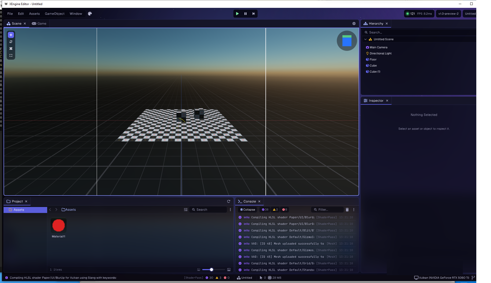

<div align="center"><sub>XEngine Editor · Vulkan backend · procedural skybox + realtime lighting · 121 FPS / 8.2 ms</sub></div>

---

## 📑 Contents

1. [What is XEngine](#-what-is-xengine)
2. [Why XEngine](#-why-xengine)
3. [Gallery](#-gallery)
4. [Completed modules](#-completed-modules)
5. [Graphics & rendering](#-graphics--rendering)
6. [First-party packages](#-first-party-packages)
7. [Platform support](#-platform-support)
8. [AI-native tooling (MCP)](#-ai-native-tooling-mcp)
9. [Architecture](#-architecture)
10. [Performance culture](#-performance-culture)
11. [Getting started](#-getting-started)
12. [Project status](#-project-status)
13. [Roadmap](#-roadmap)
14. [Contributing](#-contributing)
15. [Acknowledgments](#-acknowledgments)
16. [License](#-license)

---

## 🎮 What is XEngine

XEngine is an **open source, MIT-licensed real-time 2D/3D engine** — runtime, editor and toolchain —
written entirely in **modern C# on .NET 10 / CoreCLR**. It deliberately mirrors the Unity mental
model (GameObject + MonoBehaviour, Scene/Hierarchy/Inspector/Project/Console/Game views, prefabs,
`.meta` GUID assets) so that developers coming from Unity can move over without relearning the
fundamentals — while staying small, readable, hackable and free of engine licensing fees.

Two things make it more than a Unity clone:

- **The engine is designed for AI agents as first-class users.** MCP (Model Context Protocol) is
  built into the kernel, not bolted on as a plugin. An agent can read and edit scenes, assets,
  animation graphs, shaders and code, run the project, take screenshots and verify results — all
  through a typed, risk-classified tool surface.
- **Every source asset is human-readable text.** Scenes, prefabs, shader graphs, VFX graphs,
  timelines and settings are text that `git diff` can show and an agent can safely edit. Binary
  files exist only as import caches.

```csharp
using XEngine.Runtime;
using XEngine.Vector;

public class Spinner : MonoBehaviour
{
    public float DegreesPerSecond = 90f;

    public override void Update()
    {
        Transform.Rotate(new Float3(0f, DegreesPerSecond * Time.DeltaTime, 0f));
    }
}
```

**Scale of the codebase today:** ~353,000 lines of first-party C# across runtime, editor, packages
and tooling (1,568 files), plus ~107,000 lines of tests and ~373,000 lines of vendored, in-repo
third-party source. **4,000+ xUnit test methods** cover runtime, editor, analyzers and the AI host.

---

## ✨ Why XEngine

<table>
<tr>
<td width="25%"><b>🤖 AI-native by design</b></td>
<td>Dual MCP channels: <b>105 offline host tools</b> (scene / asset / animation / navigation /
shader graph / VFX / code / build / generation) plus <b>29 in-editor runtime tools</b> (playmode,
live scene, frame debug, screenshot, stats). Ships with <b>36 authoring skills</b> that teach an
agent how to drive the engine. Every write op carries a four-level <code>RiskLevel</code>,
<code>dryRun</code> preview, hash pre-checks and idempotency keys, and lands in a provenance
journal.</td>
</tr>
<tr>
<td><b>📝 Text-first assets</b></td>
<td>All source assets — <code>.scene</code>, <code>.prefab</code>, <code>.shadergraph</code>,
<code>.vfx</code>, <code>.timeline</code>, <code>.volumeprofile</code> — are diffable text
(Echo serializer, with a source generator). Merge conflicts are readable; agents can patch
surgically.</td>
</tr>
<tr>
<td><b>⚡ Measured performance</b></td>
<td>Zero-allocation async (<code>XTask</code>: 0.93 ns / 0 B for a synchronous completion),
Roslyn analyzers (PR0001–PR0007) that make GC allocation on hot paths a <i>compile error</i>,
BenchmarkDotNet evidence archived in-repo, and byte-exact screenshot regression harnesses.</td>
</tr>
<tr>
<td><b>🧱 Self-contained build</b></td>
<td>Companion libraries and the Slang native compiler are vendored as source in
<code>ThirdParty/</code>. <code>dotnet build</code> restores and builds offline, with no private
feeds and no external package server.</td>
</tr>
</table>

---

## 📸 Gallery

| Frame Debugger | Game view + render stats |
|:-:|:-:|
| 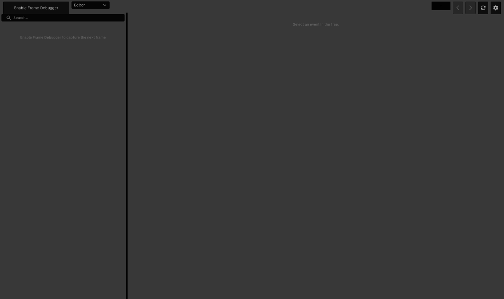 | 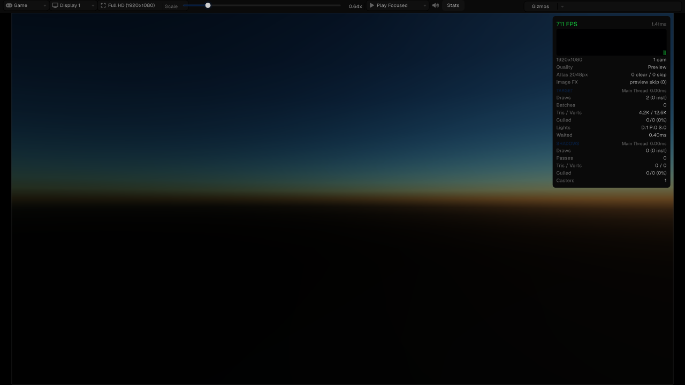 |
| Event tree, render-target channel preview, per-event render state, meshes, keywords, textures and constant buffers. | Full-HD game view with draws / batches / tris / lights / shadow-pass breakdown. |

| Spine runtime | Timeline · Package Manager · Profiler |
|:-:|:-:|
| 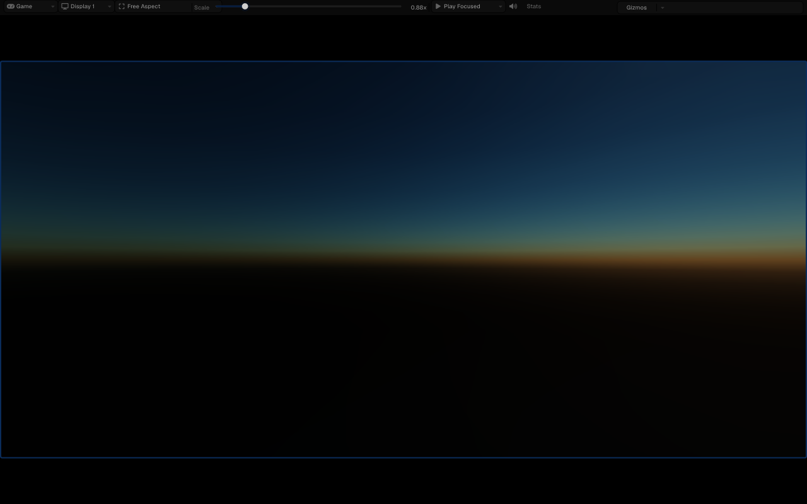 | 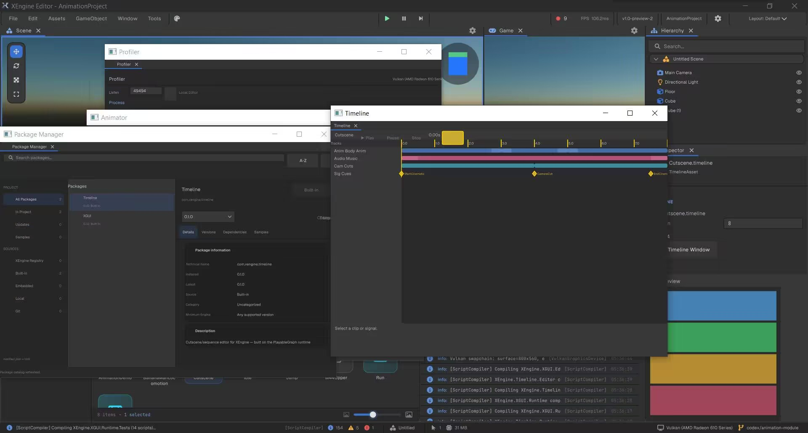 |
| Spine skeletal 2D animation with clip list, skin switching and a live inspector preview. | Multi-track cutscene editing with signals, alongside package management and the profiler. |

| Animator + animation workflow | Device simulator |
|:-:|:-:|
| 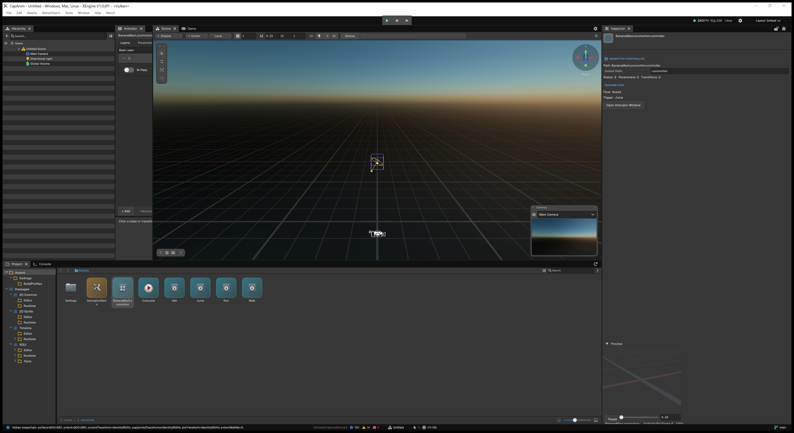 | 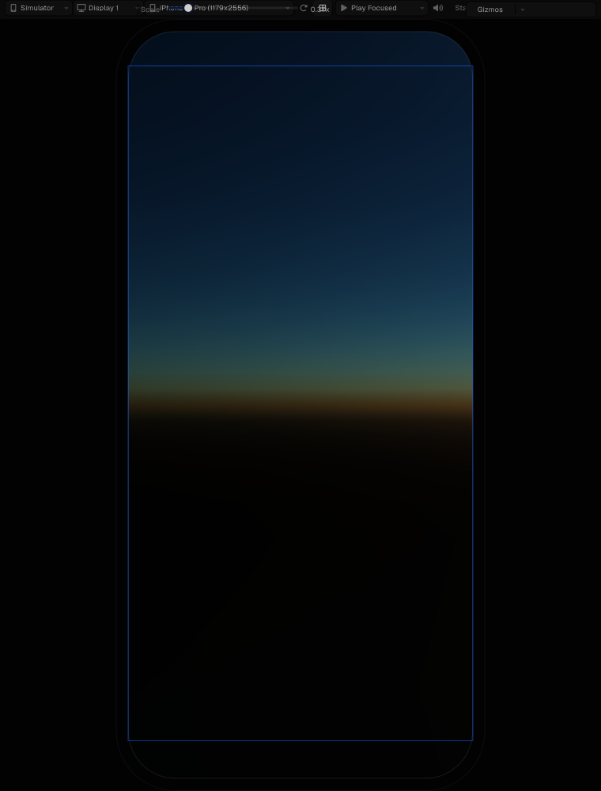 |
| Animator state machine window docked with Scene, Game, Hierarchy, Inspector and Console. | Preview at real device resolutions with safe-area and orientation switching. |

| Graphics backend switching |
|:-:|
| 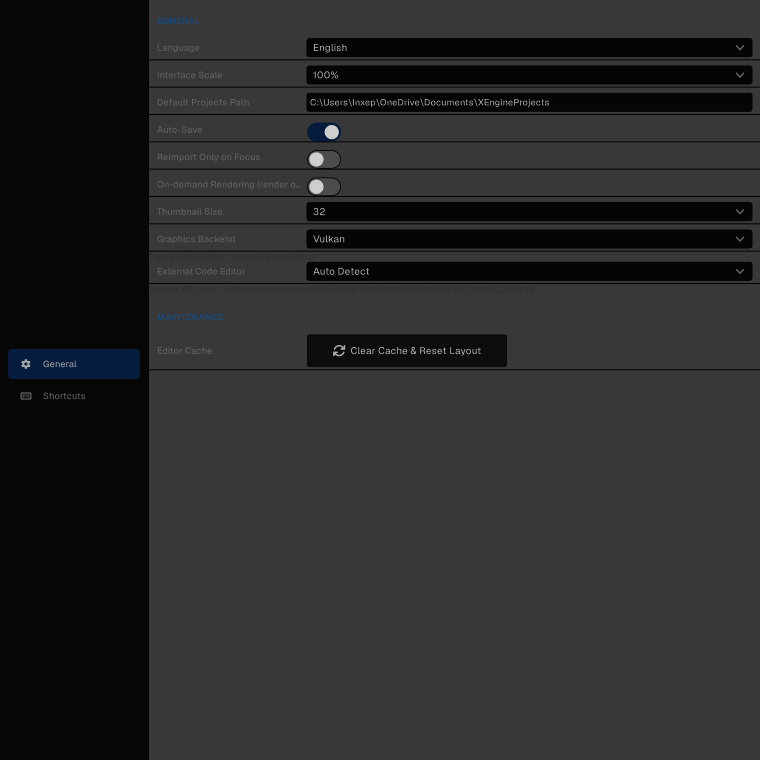 |
| One RHI, several backends — pick it in Preferences or override at launch with `--graphics=opengl\|vulkan\|d3d12`. |

---

## 🧩 Completed modules

Everything in this section is implemented and covered by tests and/or archived screenshot evidence
in the repository.

### Core runtime & editor

| Module | What you get |
|---|---|
| **Object model** | GameObject + MonoBehaviour components, tags & layers, `XEngine Actions` (Inspector-configurable persistent callbacks), full lifecycle semantics |
| **Scenes & prefabs** | Scene system with fog and ambient lighting; nested prefabs with Apply / Revert / Break Instance and override tracking |
| **Editor** | Scene View, Hierarchy, Inspector, Project Browser, Console, Game View, Profiler, Package Manager, Preferences, Build Profiles; dockable & resizable panels with persisted layouts; drag & drop; multi-select; search and filtering; asset thumbnails and 3D previews; transform gizmos; full undo/redo; rebindable shortcuts; editor themes; in-editor playtest; script hot reload |
| **Localization** | Editor UI in 12 languages (EN, DE, ES, FR, IT, JA, KO, PL, PT, RU, TR, ZH) |
| **Scripting** | C# on .NET 10 / CoreCLR; `dotnet build` compiles Game and Editor assemblies; assembly definitions; managed and native plugins |
| **XTask** | Zero-allocation async / coroutine library replacing `Task` and `IEnumerator` |
| **Serialization** | Echo text serializer with a Roslyn source generator |
| **Input** | Input Action system with `.inputactions` assets and a dedicated editor: action phases, composites (WASD → Float2, D-pad), processors; keyboard, mouse and gamepad |
| **Math** | 64-bit math library — `Float4x4`, quaternions, `Transform2D`, AABB, Bounds, Frustum, Cone, Ray, Plane, LineSegment, Rect |

### Gameplay systems

| Module | What you get |
|---|---|
| **3D physics** | Rigid bodies, box / sphere / capsule / cylinder / cone / convex hull / mesh / terrain colliders, wheel colliders with suspension and grip slip, joints and constraints (ball-socket, hinge, hinge-angle, fixed-angle, cone limit, distance limit, twist angle, prismatic, universal, point-on-line, point-on-plane, angular and linear motors), character controller, triggers, layer filtering, raycasts and shape queries |
| **2D physics** | Per-scene `PhysicsWorld2D` (1 unit = 1 m, stepped in FixedUpdate), `Rigidbody2D`, box / circle / capsule / polygon / composite colliders, collision & trigger events, `PhysicsMaterial2D`, NonAlloc `Raycast` / `OverlapCircle` / `OverlapBox`, debug drawing |
| **Animation** | Skeletal animation and blendshapes; Animator Controller state machines with layers, AvatarMask, root motion, CrossFade and blend trees; humanoid bone mapping and retargeting; animation clip editor with curves and events |
| **Playable & Timeline** | Unity-compatible `PlayableGraph` / `AnimationPlayableOutput` / custom playables; visual Timeline editor with tracks, clips, blending and signals |
| **Navigation** | Recast/Detour-style navmesh baking, `NavMeshSurface` / `NavMeshAgent` / `NavMeshObstacle` / `NavMeshLink` / modifiers & volumes, tile cache for dynamic rebuilds, crowd simulation, path queries and a Navigation window |
| **Audio** | Spatial 3D audio with attenuation and Doppler; WAV / MP3 / OGG / FLAC; effect chains (delay, distortion, biquad filter, reverb, phaser) and custom `IAudioEffect` |
| **UI** | GameObject-driven UI including World Space; `RectTransform` layout, buttons, sliders, layout groups, drag & drop events; **XGUI** retained-mode package with rich text, hyperlinks, inline sprites, safe area, IME input and batch merging |
| **2D** | Sprites, sprite atlas, sorting groups, 9-slice draw modes, tilemaps with palettes and rule tiles, SpriteShape splines, pixel-perfect camera, 2D skeletal animation (SpriteSkin / Bone2D / Sprite Library / IK), Spine runtime, PSD and Aseprite importers |
| **Terrain** | Quadtree LOD heightmap terrain, splatmap painting, GPU-instanced grass, tree rendering with LOD distance, holes, and a dedicated sculpt / paint / grass / tree / settings editor |
| **VFX** | Node-based GPU Visual Effect Graph (spawn, initialize, update, output blocks; flipbooks, mesh output, lit particles, SDF and plane collision, turbulence, soft particles, subgraphs) plus the classic CPU particle system with GPU-instanced rendering |

### Content pipeline

| Module | What you get |
|---|---|
| **Asset database** | GUID references with `.meta` files, import cache and file watching with auto-reimport, custom importers via attributes, sub-assets with deterministic GUIDs, forward and reverse dependency tracking, multi-threaded loading |
| **Formats** | Models: GLTF / GLB / OBJ / FBX · Textures: PNG / JPG / BMP / TGA / PSD / HDR / DDS / EXR · Audio: WAV / MP3 / OGG / FLAC · 2D: Aseprite, layered PSD with bones |
| **AssetBundles & hot update** | Bundle build pipeline, provider/handle reference counting, manifest versioning, virtual file system with asset streaming, LZ4 compression, downloader and decryption layering |
| **Build system** | Standalone player export, packed asset files (`.xenginepak`), used-assets-only export, per-platform build configurations, build profiles UI |
| **Provenance** | Every edit records author / intent / delta into a queryable journal — for humans and agents alike |

---

## 🎨 Graphics & rendering

**Six graphics backends behind one RHI abstraction**: Direct3D 12 · Vulkan · OpenGL · Metal ·
WebGPU · WebGL2. Vulkan, D3D12 and OpenGL are the fully accepted desktop paths today; Metal,
WebGPU and WebGL2 are in active bring-up (see [Platform support](#-platform-support)).

- **Dedicated render thread** and an extensible, scriptable render pipeline
- **Universal Render Pipeline (URP)** — `PipelineAsset` / `ScriptableRenderer` / `RendererFeature` /
  Volume / RenderGraph / RTHandle / camera stacking, aligned to URP 17.7 (Forward+, STP, SSGI, APV,
  LOD cross-fade)
- **Render paths** — Forward-Lit, Forward+, deferred GBuffer, Renderer2D
- **RenderGraph** with transient resources and raster / compute / unsafe passes
- **Realtime GI** — screen-space GI plus DDGI dynamic irradiance probe volumes, accepted across all
  six backends
- **Virtual Geometry** — Nanite-class GPU culling, cluster selection and residency management
- **Shader Graph** — node editor plus CLI `inspect` / `patch` / `compile`, emitting GLSL and Slang
- **Custom shader language** with `#include`, multi-pass, keywords and variants
- **Lighting** — HDR + PBR metallic workflow (albedo, normal, surface AO/roughness/metallic,
  emission), point / spot / directional lights, shadow maps for every light type, up to 4 cascades,
  point-light cube shadows, a dynamically packed shadow atlas, light cookies, rendering layers,
  reflection probes, baked light probes, progressive CPU lightmap baking and UV unwrapping
- **Post-processing** — ACES / Reinhard / Uncharted / Filmic / Melon / AgX tonemapping, bloom,
  FXAA / SMAA / TAA, GTAO, stochastic SSR, Bokeh depth of field, volumetric fog, lens flare,
  screen-space shadows, screen-space decals, cinematic grain / vignette / chromatic aberration;
  optional Post Processing package with a PPv2-style Layer / Volume / Profile workflow
- **Volume framework** — global and local blending via `.volumeprofile` assets
- **Renderers** — mesh, skinned mesh (skeletal + blendshapes), line, sprite, GPU instancing,
  frustum culling, LOD cross-fade with stencil
- **Also** — render textures, Texture3D, grab pass (depth-aware refraction / heat haze / frosted
  glass), transparency, procedural / cubemap / gradient skyboxes, STP temporal upscaling, MSAA
- **Debugging** — Frame Debugger (event tree, RT preview, full state inspection) and Rendering
  Debugger

---

## 📦 First-party packages

Core 2D and rendering primitives are built in; everything below ships as an optional package
installable from the in-editor Package Manager.

| Package | What it adds |
|---|---|
| `com.xengine.xgui` | Retained-mode GameObject UI |
| `com.xengine.xui` | AI-first UI application layer on top of XGUI — compact `.xui` XML screens |
| `com.xengine.timeline` | Cutscene / sequence editor on the PlayableGraph runtime |
| `com.xengine.vfx` | Node-based GPU Visual Effect Graph |
| `com.xengine.terrain` | Heightmap terrain with splat layers, grass, trees and sculpting tools |
| `com.xengine.ai.navigation` | Navmesh bake, query, agents and the Navigation window |
| `com.xengine.spine` | Esoteric Spine skeletal 2D animation runtime |
| `com.xengine.postprocessing` | PPv2-style post-processing layer / volume / profile |
| `com.xengine.feature.2d` | Meta-package pulling in every first-party 2D subpackage |
| `com.xengine.2d.*` | `common`, `sprite`, `tilemap`, `tilemap.extras`, `animation`, `spriteshape`, `pixel-perfect`, `psdimporter`, `aseprite`, `tooling` |

---

## 🌍 Platform support

| Platform | Status | Notes |
|---|---|---|
| **Windows** | ✅ Shipping | Editor and player; D3D12 / Vulkan / OpenGL |
| **Linux** | ✅ Shipping | Editor and player; Vulkan / OpenGL |
| **macOS** | ✅ Shipping | Editor and player; Metal backend in bring-up |
| **Android** | ✅ Shipping | APK / AAB build and `--build-and-run` deployment to device and emulator, Vulkan with realtime shadows, ETC2 texture variants |
| **HarmonyOS** | 🔧 In progress | Platform layer and packaging complete — Vulkan RHI baseline, NAPI native host, Hvigor project generation, HAP/APP packaging, device bridge. A packaged app runs a 3D rendering demo on a HarmonyOS 6.1 device. Compatibility-matrix acceptance ongoing. |
| **Web · WeChat / Douyin mini games** | 🔧 In progress | Export pipeline through: mini-game project generation, WXWebAssembly / TTWebAssembly loading ABI, subpackage CDN, bundle-size budget gate. A lit 3D scene renders in WeChat DevTools; main-package size optimization ongoing. |
| **iOS** | 🔧 In progress | Build pipeline skeleton in place; blocked on the Metal backend |
| **WASM (standalone)** | ⬜ Planned | Depends on the WebGPU backend |

| HarmonyOS 6.1 device | Android arm64 (Vulkan + realtime shadows) | WeChat DevTools |
|:-:|:-:|:-:|
| 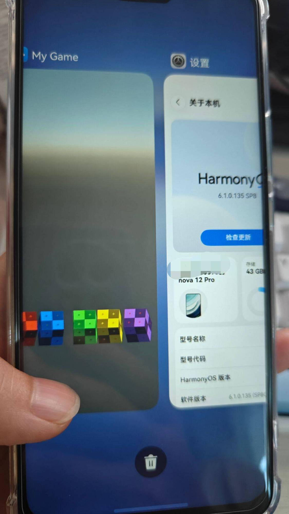 | 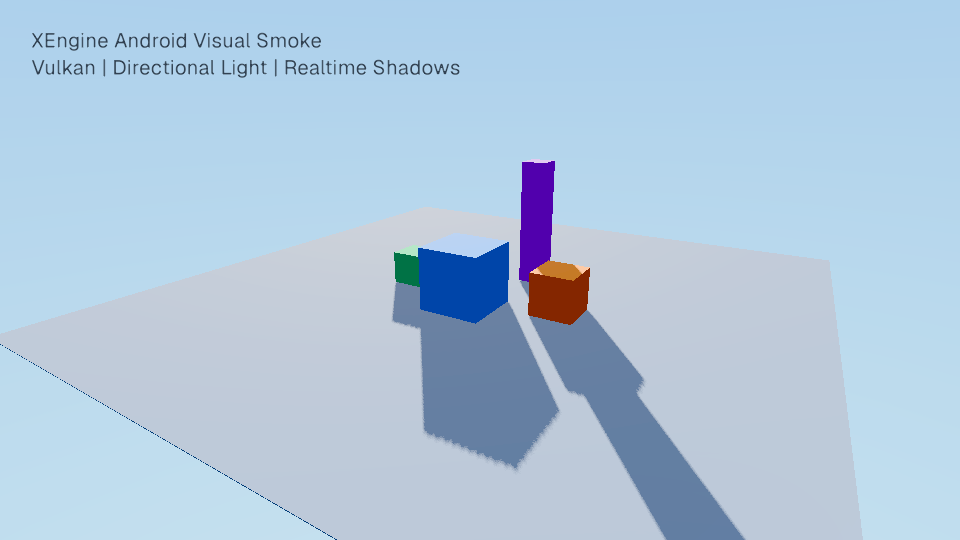 | 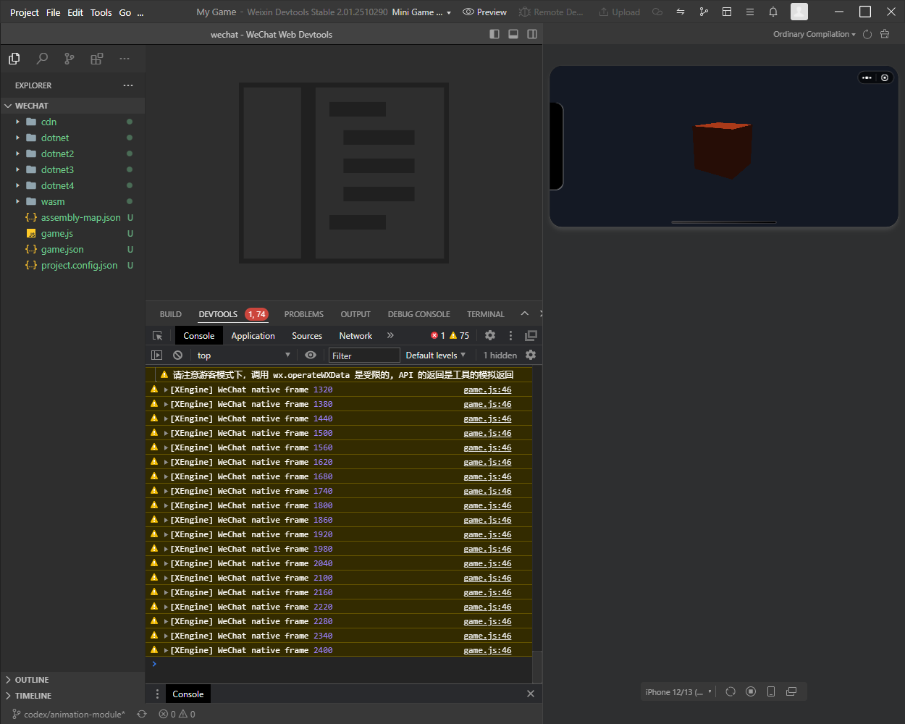 |

---

## 🤖 AI-native tooling (MCP)

XEngine exposes itself to AI agents and CLIs over **MCP on stdio**, in two channels:

- **Offline host — 105 tools.** Works on the project on disk with no editor running: scene and
  prefab editing, asset import / search / inspect / patch, animator state machines, blend trees,
  avatar masks, clip curves and events, navmesh, shader graph, VFX graph, volumes, materials,
  script create / edit / delete, code symbol search, package management, builds, headless runs,
  test runs, workflows and the generation gateway.
- **In-editor runtime — 29 tools.** Requires a live editor (`--serve`): playmode control, live
  scene mutation, selection, menus, expression eval, screenshots and panel screenshots, render
  stats, frame debug, render debug, animator and animation preview, navmesh bake and agent
  control, Spine playback and skin switching, VFX preview.

**Safety rails** are part of the protocol, not an afterthought: a capability catalog with a
four-level `RiskLevel`, `dryRun` previews, hash pre-checks against concurrent edits, idempotency
keys, and a provenance journal recording author, intent and delta for every mutation.

**36 authoring skills** (`cli/skills/`) document each workflow — editing scenes, animators, shader
graphs, VFX graphs, timelines, materials, volumes, pipelines, XUI screens; inspecting frames and
render state; generating assets; running tests, workflows and live scenes — so an agent can read the
skill and get it right the first time.

**Generative asset gateway** — `gen_submit` / `gen_status` / `gen_fetch` / `gen_candidates` and
friends front six providers: **Meshy** (3D models), **PixelLab** (sprites), **Blockade Labs**
(skyboxes), **ElevenLabs** (audio), **OpenAI GPT Image**, and self-hosted **ComfyUI**. The
generation recipe is written into the asset's `.meta`, so any asset can be regenerated
reproducibly.

---

## 🧱 Architecture

```
XEngine.sln
├── XEngine.Runtime/              # Runtime core — shippable standalone, zero editor dependencies
├── XEngine.Editor/               # Editor executable, built on Origami/Paper
├── XEngine.Runtime.Test/         # Runtime tests
├── XEngine.Editor.Test/          # Editor tests
├── Tools/
│   ├── XEngine.Ai.Host/          # Offline MCP host (105 tools)
│   ├── XEngine.Ai.Server/        # In-editor MCP service (29 runtime tools)
│   ├── XEngine.Ai.Gateway/       # Generative asset gateway (6 providers)
│   ├── XEngine.Analyzers/        # Performance analyzers (PR0001–PR0007)
│   ├── XEngine.Data.Provenance/  # Provenance journal
│   └── XEngine.Runtime.Benchmarks/
├── Packages/                     # First-party packages (com.xengine.*)
├── Libraries/                    # Native libraries per RID (miniaudio, …)
├── ThirdParty/                   # Vendored source — no external package feeds
│   ├── Echo/                     # Serialization (+ source generator)
│   ├── Vector/                   # 64-bit math
│   ├── Paper/ Origami/           # Immediate-mode UI framework + editor widget library
│   ├── Quill/ Scribe/            # Vector graphics + TrueType parsing & glyph rasterization
│   ├── Clay/                     # Model import (GLTF/GLB/OBJ/FBX)
│   ├── Photonic/ Unwrapper/      # Progressive lightmap baking + UV unwrap
│   ├── Jitter2/                  # 3D physics
│   ├── Slang/ Graphite/          # Shader compiler wrapper + Vulkan abstraction
│   ├── Rosetta/ Wicked/          # Localization + networking (IL-weaved RPC & SyncVar)
│   └── Crumb/ Drift/             # Utility libraries
├── cli/skills/                   # 36 agent authoring skills
├── Samples/                      # Sample projects
└── docs/                         # Documentation, screenshots, benchmark evidence
```

---

## 📊 Performance culture

Performance decisions here are made from **measured frame time, throughput, allocation and GPU
cost** — never from intuition. The repository enforces that:

- **`XEngine.Analyzers` (PR0001–PR0007)** — Roslyn analyzers for per-frame CPU hot paths: banned
  LINQ, `[HotPath]` detection, allocation detection. Relaxing a rule or widening an allow-list
  without benchmark evidence and matching tests is not accepted.
- **`XEngine.Runtime.Benchmarks`** — BenchmarkDotNet suites with reproducible evidence archived
  under `docs/benchmarks/`.
- **Performance contract tests** — e.g. `FrameLoopPerformanceContractTests`,
  `StageAPerformanceContractTests`, plus zero-allocation probes that reproduce allocation byte
  counts round over round.
- **Byte-exact screenshot regression** across graphics backends, so a rendering change that alters
  pixels cannot land unnoticed.

Representative measurements: `XTask` synchronous completion at **0.93 ns / 0 B**; six Transform
paths at **0 B** allocation; editor idle at **0.365 % of one CPU core** (empty scene, idle,
Release + Vulkan, 30 s sample).

---

## 🚀 Getting started

### Prerequisites

- [.NET 10 SDK](https://dotnet.microsoft.com/en-us/download/dotnet/10.0)
- A GPU with Vulkan, D3D12 or OpenGL 4.1+ support
- Recommended IDE: Visual Studio 17.8+, VS Code, or JetBrains Rider

### Build and run

```bash
dotnet restore XEngine.sln
```

```bash
dotnet build XEngine.sln -c Debug
```

```bash
dotnet run --project XEngine.Editor
```

Pick a graphics backend at launch:

```bash
dotnet run --project XEngine.Editor -- --graphics=vulkan
```

> Companion libraries and the Slang native compiler are vendored in `ThirdParty/`, so restore and
> build work fully offline — no private feeds, no extra package sources.

### Connect an AI agent

Point any MCP client at the offline host, or start the editor with `--serve` to expose the runtime
tools as well. Skills in `cli/skills/` describe each workflow.

---

## 📌 Project status

**α0.1 preview.** The runtime, editor, renderer, physics, audio, animation, UI and asset pipeline
have all been rewritten and are exercised by 4,000+ automated tests. This is a preview: APIs will
change, some subsystems (Metal, WebGPU/WebGL2, iOS, HarmonyOS acceptance) are still in bring-up,
and the ecosystem around the engine is young. It is meant for people who want to build with — or
on — an engine they can read end to end.

---

## 🧭 Roadmap

Long term, XEngine aims to cover the core feature set of a modern general-purpose engine so that
existing projects can migrate at low cost, while keeping its own character (Paper UI, XTask, Echo,
MCP). Highlights of what is next:

| Area | Next up |
|---|---|
| **Rendering** | Metal backend (unblocks iOS), SRP batcher, GLES3 mobile tuning, adaptive performance, FSR upscaling |
| **Platforms** | HarmonyOS compatibility-matrix acceptance and Beta, mini-game package-size gate, iOS export, standalone WASM |
| **Gameplay** | Cinemachine-style virtual cameras, animation rigging / runtime IK, behaviour trees |
| **Networking** | Wiring the vendored networking library into the runtime — `NetworkManager` / `NetworkBehaviour` / network transform, pluggable transports, multiplayer playmode |
| **Data** | Addressables-style addressed loading with groups and remote CDN |
| **Tooling** | Presets, quick search, grid & snap, project auditor, recorder, visual scripting, in-editor version control |
| **Performance** | Job system for data parallelism, ECS evaluation, NativeAOT + intrinsics as a Burst equivalent |

Explicitly out of scope: XR/AR/VR, cloud gaming services, and legacy deprecated stacks.

---

## 🤝 Contributing

Contributions are welcome. Please read [CONTRIBUTING.md](CONTRIBUTING.md) and
[CODE_OF_CONDUCT.md](CODE_OF_CONDUCT.md) first.

Before changing code, read the skill guide for the area you are touching (`skills/`):

- **LINQ performance** (`skills/linq-performance/`) — PR0001 and the LINQ allow-list
- **Hot path performance** (`skills/hot-path-performance/`) — `[HotPath]`, PR0002–PR0007, pooling
- **Rendering & GPU** (`skills/rendering-gpu-performance/`) — pipeline, RHI, GPU resources
- **Performance validation** (`skills/performance-validation/`) — benchmarks, regression evidence

**Do not relax an analyzer rule or widen an allow-list without benchmark evidence and matching
tests.**

---

## 🙏 Acknowledgments

### Lineage

XEngine stands on the shoulders of giants:

- **[Prowl Game Engine](https://github.com/ProwlEngine/Prowl)** by **Michael Sakharov / Wulferis**
  (MIT). XEngine evolved from Prowl's core architecture and render pipeline. Prowl's copyright
  notice: `MIT License — Copyright (c) 2023 Michael Sakharov`.
- **[Anthology](https://github.com/ProwlEngine/Anthology)** by **Wulferis** (MIT) — Echo, Paper,
  Origami, Quill, Scribe, Clay, Vector, Photonic, Unwrapper, Rosetta, Wicked, Graphite, Slang,
  Crumb and Drift, vendored as source under `ThirdParty/`.
  `Copyright (c) 2026 Wulferis`.
- **[Raylib](https://github.com/raysan5/raylib)** — Prowl's early foundation, which accelerated the
  engine's path to usability.

### Design references

XEngine's AssetBundle system and asset management layer were independently reimplemented under MIT
with reference to the **design** (not the source or type names) of
**[YooAsset](https://github.com/tuyoogame/YooAsset)** (Apache 2.0),
Unity **ScriptableBuildPipeline** (Unity Companion License).

### Core dependencies

| Library | Used for | Source |
|---|---|---|
| **Anthology** (Echo / Paper / Origami / Quill / Scribe / Clay / Vector / Photonic / Unwrapper / Rosetta / Wicked / Graphite / Slang / Crumb / Drift) | Serialization, UI, vector graphics, text, model import, math, lightmap baking, UV unwrap, localization, networking, render abstraction | Vendored source (`ThirdParty/`, MIT) |
| [Silk.NET](https://github.com/dotnet/Silk.NET) | Windowing, input, OpenGL / Vulkan bindings | NuGet |
| [Vortice.Direct3D12](https://github.com/amerkoleci/Vortice.Windows) | Direct3D 12 bindings | NuGet |
| [Jitter Physics 2](https://github.com/notgiven688/jitterphysics2) | 3D physics | Vendored source (MIT, locally patched) |
| [Box2D.NET](https://github.com/ikpil/Box2D.NET) | 2D physics (Box2D 3.1 bindings) | NuGet |
| [Magick.NET](https://github.com/dlemstra/Magick.NET) | Image processing for texture import | NuGet |
| [Slang](https://github.com/shader-slang/slang) | Shader compiler | MIT, native binaries vendored |
| [K4os.Compression.LZ4](https://github.com/MiloszKrajewski/K4os.Compression.LZ4) | LZ4 block compression for AssetBundles | MIT, NuGet |
| [DotRecast](https://github.com/ikpil/DotRecast) | Navmesh generation and pathfinding | Vendored source (`ThirdParty/DotRecast/`, zlib) |
| [spine-csharp](https://github.com/EsotericSoftware/spine-runtimes) | Spine skeletal animation runtime | Spine Runtimes License |

Full third-party notices live in [THIRD_PARTY_NOTICES.md](THIRD_PARTY_NOTICES.md).

### Prowl contributors

The following people contributed to upstream Prowl; XEngine inherits their work:

[Michael (Wulferis)](https://twitter.com/Wulferis) · [Abdiel Lopez](https://github.com/PaperPrototype) ·
[Josh Davis](https://github.com/10xJosh) · [ReCore67](https://github.com/recore67) ·
[Isaac Marovitz](https://github.com/IsaacMarovitz) · [Kuvrot](https://github.com/Kuvrot) ·
[JaggerJo](https://github.com/JaggerJo) · [Jihad Khawaja](https://github.com/jihadkhawaja) ·
[Jasper Honkasalo](https://github.com/japsuu) · [Kai Angulo](https://github.com/sinnwrig) ·
[Bruno Massa](https://github.com/brmassa) · [Mark Saba](https://github.com/ZeppelinGames) ·
[Chandler Cox](https://github.com/Tryibion) · [EJTP](https://github.com/EJTP) ·
[Paolo](https://github.com/xZekro51) · [Kouame Benoit Junior Augustin](https://github.com/ZedDevStuff)

---

## 📜 License

XEngine is distributed under the **MIT License**. See [LICENSE](LICENSE).

```
MIT License
Copyright (c) 2026 Flamesky
```

XEngine derives from [Prowl Game Engine](https://github.com/ProwlEngine/Prowl) (MIT) and vendors
its Anthology companion libraries (MIT) along with the Slang compiler's native libraries (MIT).
Those upstream copyright notices are **not** merged into this LICENSE file — they are preserved in
full in [THIRD_PARTY_NOTICES.md](THIRD_PARTY_NOTICES.md) and in
[Acknowledgments](#-acknowledgments) above. The MIT License permits this kind of derivation and
redistribution.

---

<div align="center"><sub>XEngine — built for developers, and for the agents working alongside them.</sub></div>
